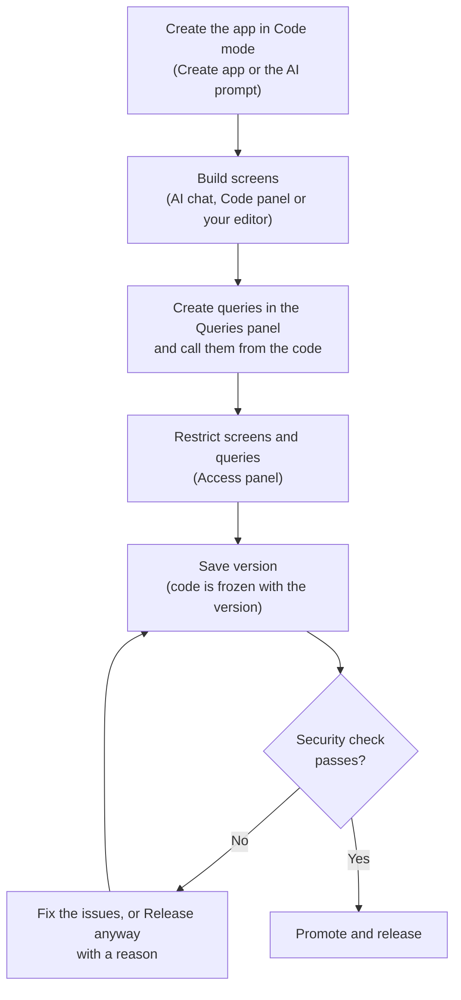

  
 Paid feature

**Code mode** lets you build a ToolJet app as a React and TypeScript project instead of dragging components onto a canvas. You write the screens in code, with ToolJet's AI, in the ToolJet editor, or in your own editor and coding agent. ToolJet still handles sign-in, permissions, environments, data sources and queries, so the code only draws the screens and calls queries by name.

Use Code mode when you need a layout, interaction or styling that is easier to write than to assemble from components, or when your team wants to review and version the app as code.

## Code Mode and Visual Mode

Every app is created in one of two build modes, and it keeps that mode for its whole life.

| 
 
 | 
 Visual Mode 
 | 
 Code Mode 
 |
|:---------- | :---------- | :---------- |
| How you build the UI | Drag components onto a canvas and set their properties. | Write React components, or ask the AI to write them. |
| Where the UI lives | The app definition in ToolJet. | A React + TypeScript project stored on ToolJet, with its own files. |
| Data | Queries in the **Queries** panel. | The same queries. The code runs them by name. |
| Pages and navigation | ToolJet pages. | **Screens**: routes declared in the project's `app.json`. |
| Styling | Themes and component styles. | Tailwind classes and theme tokens that follow the app's ToolJet theme. |
| Editing tools | Component inspector, pages panel. | Code panel, style inspector, your own editor through the CLI. |
| Security checks before release | None | Every version is checked. A version that fails the workspace policy can't be released. |

The dashboard marks Code mode apps with a **Code** tag on their card, and the editor header shows a **Code mode** or **Visual mode** badge next to the app name.

## How It Works

A Code mode app has three parts:

- **The project.** `app.json` names the app and its screens. `frontend/` holds the React + TypeScript source, styles and `package.json`. ToolJet stores the project with the app version, so the editor, the AI and the CLI all work on the same files. See [Project Structure](/docs/app-builder/code-mode/project-structure).
- **ToolJet's platform.** Queries, data sources, environments, users, groups and permissions stay in ToolJet. The code reads data only through the app's queries, with hooks such as `useAppQuery('listShipments')`. See [Runtime API](/docs/app-builder/code-mode/runtime-api).
- **The build.** ToolJet builds the project into the app's own component library and draws it on a single **code page**. Each screen also gets a hidden ToolJet page that carries its permissions. See [Access Control](/docs/app-builder/code-mode/access-control).

The app's code runs in an isolated frame. It can reach ToolJet only through a checked channel, so it can't read the viewer's session or cookies. By default, it can't call any address other than the ToolJet instance. See [App Security](/docs/app-builder/code-mode/security).

## Three Ways to Build

You can mix these freely. Every change from every source lands in the same [App history](/docs/app-builder/code-mode/versions-and-history#app-history).

| 
 Where 
 | 
 What You Do 
 | 
 Learn More 
 |
|:---------- | :---------- | :---------- |
| **AI chat** | Describe the app or a change. ToolJet plans it, writes the code and builds it on the canvas. | [Create a Code Mode App](/docs/app-builder/code-mode/create-app) |
| **The ToolJet editor** | Edit files in the **Code** panel, or restyle elements with the style inspector, and see the result on the canvas. | [The Code Mode Editor](/docs/app-builder/code-mode/editor) |
| **Your own editor or coding agent** | Clone the app with the ToolJet CLI, run `tooljet app dev`, and your saves show live on your canvas in ToolJet. Claude Code, Codex, Cursor and other agents can build the app through the same CLI and the ToolJet MCP server. | [Work Locally](/docs/app-builder/code-mode/local-development) |

## The App Lifecycle

1. **Create** the app with the **Code mode** build mode. See [Create a Code Mode App](/docs/app-builder/code-mode/create-app).
2. **Build** the screens. ToolJet checks the draft's code automatically after each save and build.
3. **Restrict access.** A restricted screen is hidden, but its data is protected only by restricting the queries it uses. See [Access Control](/docs/app-builder/code-mode/access-control).
4. **Save a version.** **Save version** freezes the built code with the version, so a released version always runs the code it was saved with. See [Versions, History and Git](/docs/app-builder/code-mode/versions-and-history).
5. **Release.** Release and promotion wait until the version's security check passes under the workspace's scan policy. See [App Security](/docs/app-builder/code-mode/security).

## Availability

Code mode is available on ToolJet Enterprise Edition and ToolJet Cloud. It isn't available in the Community Edition. On an edition without Code mode, the **Build mode** choice doesn't appear and every new app is a visual app.
<!-- TODO verify: plan gating at launch. The code currently allows Code mode on every plan of the enterprise editions ("for now"); confirm the plans before release. -->

Some features inside Code mode follow your plan:

- Screen and query permissions in the **Access** panel need a plan that includes page and query permissions.
- **Compare versions**, version reviews and the query changes in **See what changed** need the Pro plan or above. See [Compare and Review Versions](/docs/development-lifecycle/release/version-reviews).

### Roles and Permissions

| 
 Action 
 | 
 Who Can Do It 
 |
|:---------- | :---------- |
| Create a Code mode app | Anyone who can create apps |
| Read and edit the app's code | Anyone who can edit the app. A builder who can only view the app can read the code. |
| Restrict screens and queries | Anyone who can edit the app |
| Release a version that fails the security check (**Release anyway**) | Workspace admins, or app editors with release permission |
| Change the workspace scan policy, exceptions and allowed addresses | Workspace admins |

## Next Steps

1. [Create a Code mode app](/docs/app-builder/code-mode/create-app)
2. [Learn the Code mode editor](/docs/app-builder/code-mode/editor)
3. [Work on the app in your own editor](/docs/app-builder/code-mode/local-development)
4. [Read data with the runtime API](/docs/app-builder/code-mode/runtime-api)
5. [Control who can open screens and run queries](/docs/app-builder/code-mode/access-control)
6. [Save, compare and release versions](/docs/app-builder/code-mode/versions-and-history)
7. [Understand security checks and the release gate](/docs/app-builder/code-mode/security)
