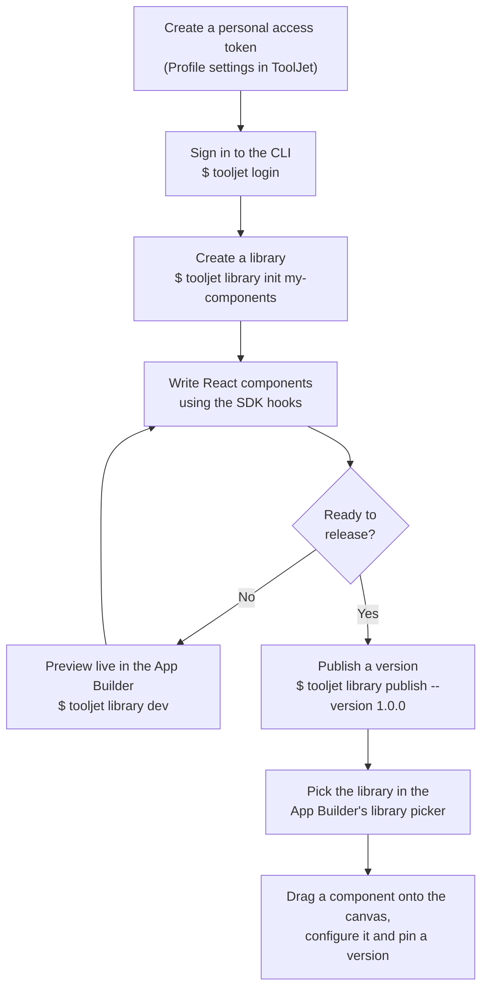

  
 Paid feature

:::caution BETA
Custom Component Libraries are currently in beta and not recommended for production use.
:::

**Custom Component Libraries** let you write your own React components, publish them to a ToolJet workspace with the [ToolJet CLI](https://www.npmjs.com/package/@tooljet/cli), and use them in the App Builder like any built-in component. Every app builder in the workspace can drag them onto the canvas. Each app pins a version of the library, and builders configure the components from the component properties panel.

A **library** is what you publish and version. The **components** inside it are what app builders drag onto the canvas. One publish ships every component in the library as a single version.

## What You Can Do

<SectionSubtitle text="Bring your own React components into the App Builder, in three steps." />

<CardGrid columns={3}>
  <FeatureCard
    icon="🧩"
    title="Build your own components"
    description="When the built-in components don't cover what you need, write your own in React and TypeScript."
    href="/docs/app-builder/custom-component-library/build-components"
  />
  <FeatureCard
    icon="📦"
    title="Publish them as a library"
    description="Package your components as a library and publish it to your workspace with the ToolJet CLI. Every publish is a new version."
    href="/docs/app-builder/custom-component-library/preview-and-publish"
  />
  <FeatureCard
    icon="🖱️"
    title="Use them like built-in components"
    description="Pick your library in the App Builder, drag a component onto the canvas and set its properties, as you would for any other component."
    href="/docs/app-builder/custom-component-library/use-in-app-builder"
  />
</CardGrid>

:::info Publish only code you trust
A custom component's code runs inside the app page, so it can read what's on the page and act as the person using the app. Only admins and builders can publish a library.
:::

## How It Works

Four parts of ToolJet are involved, and you use them in this order:

| 
 Part 
 | 
 What It Is 
 | 
 Who Uses It 
 |
|:---------- | :---------- | :------------ |
| `@tooljet/cli` | An npm CLI that scaffolds, builds, previews and publishes a library. | Developer |
| `@tooljet/custom-component-sdk` | A TypeScript package with the `ToolJet` hooks a component uses to declare its properties, events and actions. | Developer, in component code |
| **Workspace settings** → **Custom component libraries** | Lists every library published to the workspace and lets an admin delete one. | Workspace admin |
| The library picker in the **App Builder** | Where you pick a published library under Custom libraries, drop its components on the canvas and configure them. | App builder |

The end-to-end flow is shown below. Steps with a `$` are CLI commands you run in a terminal. The other steps happen in ToolJet or in your code editor.

## Before You Start

Custom Component Libraries are a paid feature, and the Community Edition doesn't include them. On a plan without them, the Custom libraries group in the App Builder's library picker and the **Custom component libraries** page in workspace settings are hidden.

### Roles and Permissions

| 
 Action 
 | 
 Required Role 
 |
|:---------- | :---------- |
| Create a personal access token | Admin or Builder |
| Create, publish and dev-preview a library (with the CLI) | Admin or Builder, with a token |
| Browse and use components in the App Builder | Any member who can edit apps |
| Delete a library | Admin only |

### Prerequisites

To build a library, you need:

- **Node.js** 18 or later and **npm**.
- **The ToolJet CLI**. See [Sign In to the CLI](./setup.md#sign-in-to-the-cli) for the install command.
- **React 18**. The scaffold pins `^18.2.0`. ToolJet provides React to the component at runtime, so your components must not bundle their own copy.

:::info
A personal access token belongs to one workspace. To publish the same library to a second workspace, create a token in that workspace and run the CLI again with it.
:::

## Next Steps

1. [Set up the CLI and create a library](./setup.md)
2. [Build components with the SDK](./build-components.md)
3. [Preview and publish your library](./preview-and-publish.md)
4. [Use custom components in the App Builder](./use-in-app-builder.md)
5. [Manage libraries in your workspace](./manage-libraries.md)

For every command, flag and limit in one place, see the [CLI Reference](./cli-reference.md).
