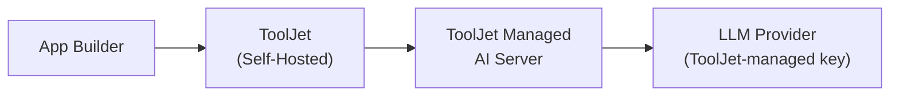

<PlanBadge type="self-hosted" />

Self-hosted ToolJet instances can use ToolJet-managed AI instead of deploying a separate AI server. AI requests from your instance are sent over the internet to ToolJet Managed AI Server, authenticated with ToolJet-managed LLM credentials, and billed against your instance's AI credits.



:::info
See [Setup ToolJet AI &rarr; Overview](/docs/setup/tooljet-ai/overview) for how this fits alongside the other AI setups and how the request is processed end-to-end.
:::

## Prerequisites

- A ToolJet license with the AI feature enabled.
- Outbound HTTPS (443) access from your ToolJet server to ToolJet Managed AI Server.

## Whitelisting Network Access

If your instance runs behind a firewall, proxy, or restricted egress policy, allow outbound HTTPS access to the following domains:

| Domain | Purpose |
|---|---|
| `https://ai-server.tooljet.ai` | ToolJet Managed AI Server, which receives AI requests such as app builds, AI chat, and attachments |
| `https://api-gateway.tooljet.ai` | Routes AI requests to the configured LLM provider |
| `https://python-server.tooljet.ai` | Backs AI operations that require the Python execution service |


If your instance uses an [HTTP proxy](/docs/setup/http-proxy), make sure these domains are reachable through it.

## Closed or Private Networks

If your ToolJet instance can't be reached from the internet (for example, it runs on a private network or behind a firewall that allows outbound HTTPS but blocks inbound traffic), ToolJet Managed AI Server can't connect back to your instance to create and update the apps it builds.

To use the AI builder in this setup, add the following environment variable to your ToolJet server and restart it:

```bash
ENABLE_MCP_SOCKET_RELAY=true
```

With this variable set, ToolJet runs the MCP server the AI builder uses inside its own container. The AI server sends its requests over the outbound connection your instance has already opened, and the MCP server applies them by calling ToolJet locally. Your instance needs no inbound access, and the session the MCP server uses stays on your host.

If ToolJet logs `MCP socket relay is enabled but no bundle at /app/mcp/index.js; staying off.`, your image doesn't include the MCP server and the relay stays turned off. Use the ToolJet Enterprise Edition image.

### Point the MCP Server at ToolJet Inside the Container

Use `TOOLJET_MCP_API_URL` to set the address the MCP server uses to call ToolJet. On some versions, the MCP server calls ToolJet at your `TOOLJET_HOST` URL. On a closed network, that address often can't be reached from inside the container. When that happens, AI chat responds but every page, theme, and component save fails with `fetch failed`, and nothing appears in the server logs.

<!-- TODO verify: name the release that ships ToolJet/ee-server#1072, after which the MCP server calls ToolJet over loopback by default and this variable is only an override. -->

To have the MCP server call ToolJet directly inside the container:

1. Find the port the ToolJet server listens on inside the container:
   ```bash
   docker compose exec tooljet printenv PORT
   ```
   If the output is empty, the port is `3000`. With the standard ToolJet Docker Compose setup, it's `80`.
2. Add the variable to your ToolJet `.env` file, replacing `<PORT>` with the port from step 1:
   ```bash
   TOOLJET_MCP_API_URL=http://127.0.0.1:<PORT>
   ```
   For the standard Docker Compose setup, this is `TOOLJET_MCP_API_URL=http://127.0.0.1:80`. If you set `SUB_PATH`, add it to the end of the URL, for example `http://127.0.0.1:80/tooljet/`.
3. Restart the ToolJet container.

## Setup

1. Confirm your license includes AI credits. If you need to purchase more, follow the **Self-Hosted Deployment** steps under [Buy Add-on Credits](/docs/build-with-ai/ai-credits#buy-add-on-credits).
2. Whitelist the domains listed above in your firewall, proxy, or network egress rules.
3. If your instance can't be reached from the internet, set `ENABLE_MCP_SOCKET_RELAY=true` as described in [Closed or Private Networks](#closed-or-private-networks).
4. No further configuration is needed. AI features become available in your workspace automatically, billed against your instance's pooled AI credits.

## Billing

Credits are pooled at the **instance level** for self-hosted deployments. See [Understanding AI Credits](/docs/build-with-ai/ai-credits#credit-allocation) for details.

## Switching the AI Provider

With this setup, each user can pick the LLM provider and model for their own AI chats. See [Selecting an AI Model](/docs/build-with-ai/model-selection) for details.

## Switching to a Different Setup

- On Self-hosted Enterprise, use your own LLM API key while continuing to route requests through ToolJet Managed AI Server with [Bring Your Own Key (BYOK)](/docs/setup/tooljet-ai/bring-your-own-key).
- To keep all AI traffic entirely within your own infrastructure with no data sent to ToolJet Managed AI Server, see [Setup ToolJet Enterprise AI](/docs/setup/tooljet-ai/tj-ai-enterprise).
