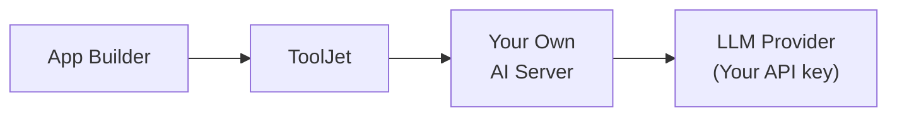

<PlanBadge type="enterprise" />
<PlanBadge type="self-hosted" />

ToolJet AI Enterprise is designed for organizations that require complete control over where their data is processed. Rather than routing AI requests through ToolJet Managed AI Server, you deploy a ToolJet-provided server image within your own environment. All AI workloads execute on your servers, using your own LLM API key, no data is transmitted to or processed by ToolJet at any point.

This is particularly relevant for organizations operating under strict data residency regulations, internal compliance policies, or those running in air-gapped or private-cloud environments where external network calls to third-party servers are not permitted.

Benefits of ToolJet AI Enterprise:

- **Cost control**: Usage is billed directly to your LLM provider account. ToolJet does not charge ToolJet AI credits for these requests.
- **Visibility**: You can monitor usage and set spending limits through your LLM provider's dashboard.
- **Full data isolation**: All AI execution happens on infrastructure you control. ToolJet servers are not involved in processing requests.
- **Flexible key management**: Supply your API key through the ToolJet UI or inject it directly as an environment variable on the server. Using an environment variable is preferable for secrets management in automated or containerized deployments.

:::info Not available on ToolJet Cloud
ToolJet AI Enterprise requires that you deploy and operate the ToolJet-provided server image yourself.
:::

## Deploying the Server Image

Please reach out to our support team at [support@tooljet.com](mailto:support@tooljet.com). They will assist you with the server image and the steps required to deploy it.

Once the AI server is running, point ToolJet at it by setting the following environment variable on your ToolJet server:

| Variable | Default | Description |
|:---------|:--------|:------------|
| `AI_SERVER_URL` | `http://localhost:3004` | Base URL of your AI server. ToolJet sends every AI request from the instance, including app builds, AI chat, and attachments, to this URL. |

If `AI_SERVER_URL` isn't set, ToolJet sends AI requests to `http://localhost:3004`, which works only when the AI server is reachable on that port from the ToolJet server itself. When ToolJet runs in a container, `localhost` is the ToolJet container, so set `AI_SERVER_URL` to the AI server's address on your network.

:::caution
`AI_SERVER_URL` overrides the AI server for the whole instance, whatever the license or provider. Set it only when you run your own AI server.
:::

## Configuring Your API Key

There are two methods for providing your LLM API key to the server:

### Configure via the ToolJet UI

This method is suitable when you prefer centralised key management through the ToolJet interface.

1. Navigate to **Settings → LLM key**. This is an instance setting available to super admins.
    
2. Select the provider you want to use: **Anthropic**, **Grok**, **OpenAI**, or **OpenRouter**. If you select **OpenRouter**, also select a model from the **Model** dropdown.
    
3. After that, enter your API key from your LLM provider (e.g., your Anthropic API key from [console.anthropic.com](https://console.anthropic.com)).
4. Click **Save changes**.

ToolJet will securely forward the key to your server when making AI requests.

### Use an Environment Variable

This method is recommended for production deployments, CI/CD pipelines, or environments where secrets should not be entered through a UI.

1. Configure the following environment variables on your ToolJet server:
    1. `LLM_PROVIDER`: You can set your LLM Provider using this variable.
        | Value | When to use |
        |:------|:------------|
        | `anthropic` | When you want to use Anthropic API Key |
        | `grok` | When you want to use Grok API Key |
        | `openai` | When you want to use OpenAI API Key |
        | `openrouter` | When you want to use OpenRouter API Key |
        | `tooljet_managed` | When you want to use ToolJet Managed AI Credits. |
    2. Set the following variable according to which LLM Provider you are using:
        - `ANTHROPIC_API_KEY=<your-api-key>`: If you are using Anthropic.
        - `GROK_API_KEY=<your-api-key>`: If you are using Grok.
        - `OPENAI_API_KEY=<your-api-key>`: If you are using OpenAI.
        - `OPENROUTER_API_KEY=<your-api-key>`: If you are using OpenRouter.
2. Once you have configured the above variables, navigate to **Settings → LLM key** and turn on the **Apply configuration from environment variables** toggle.
    

When you turn on the toggle, ToolJet checks that `LLM_PROVIDER` is set to one of the values listed above and that the matching API key variable is set. If either check fails, the toggle stays off and an error names the missing or invalid variable. Other values, such as `gemini`, are rejected.

ToolJet reads the key from its own environment at runtime and forwards it to your AI server with each request. Any key previously entered in the UI is cleared. With environment variables, you can't select an OpenRouter model.

## Supported Providers

**Currently, Anthropic, Grok, OpenAI, and OpenRouter are supported.** Support for additional LLM providers is planned for future releases.

## Frequently Asked Questions

**What is the difference between BYOK and ToolJet AI Enterprise?**

With BYOK, your API key is used but requests are still routed through ToolJet Managed AI Server. With ToolJet AI Enterprise, you host the server yourself, no data leaves your infrastructure at any point.

**Is ToolJet AI Enterprise available on ToolJet Cloud?**

No. ToolJet AI Enterprise requires you to deploy and operate the ToolJet-provided server image within your own infrastructure.

**Which method of API key configuration should I use?**

For production or automated deployments, environment variables are recommended as they keep secrets out of the UI and align with standard secret management practices. The UI method is suitable for simpler setups or development environments.

**What happens if both the UI key and the environment variable are configured?**

When the **Apply configuration from environment variables** toggle is enabled, the server uses the environment variable and ignores any key entered via the UI.

**Can I use ToolJet AI Enterprise in an air-gapped environment?**

Yes, provided the server image can be deployed within your network and your LLM provider's API is accessible from that environment.

